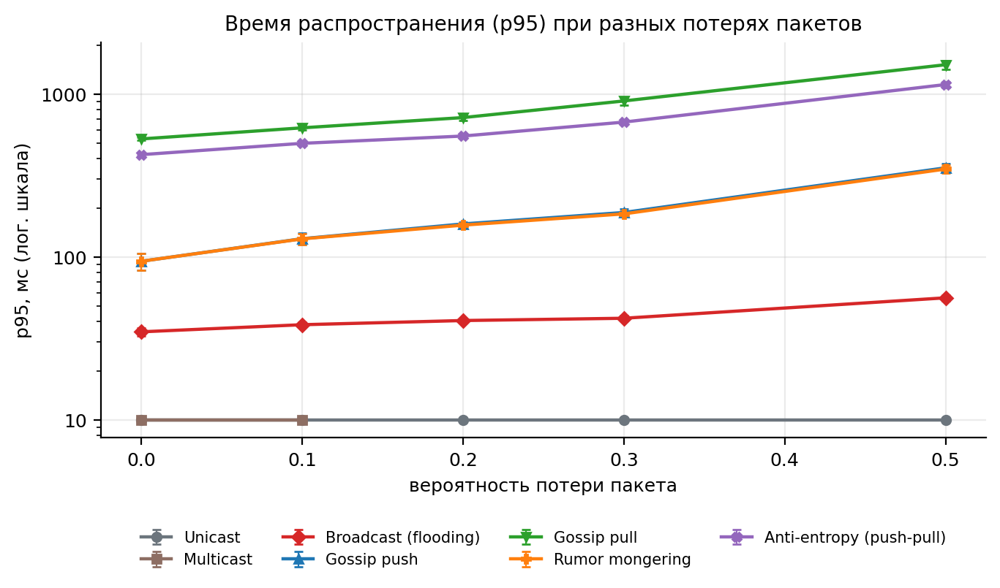
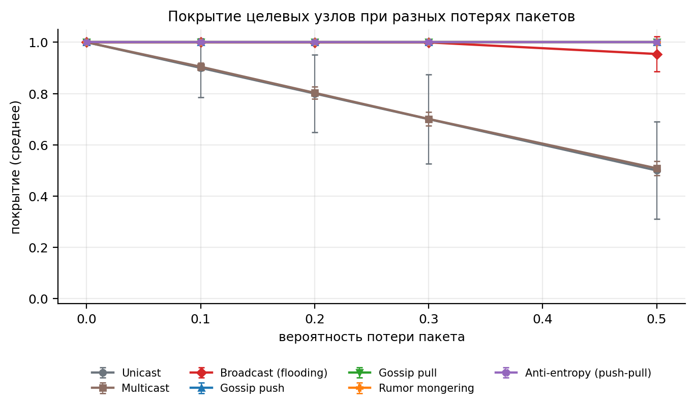
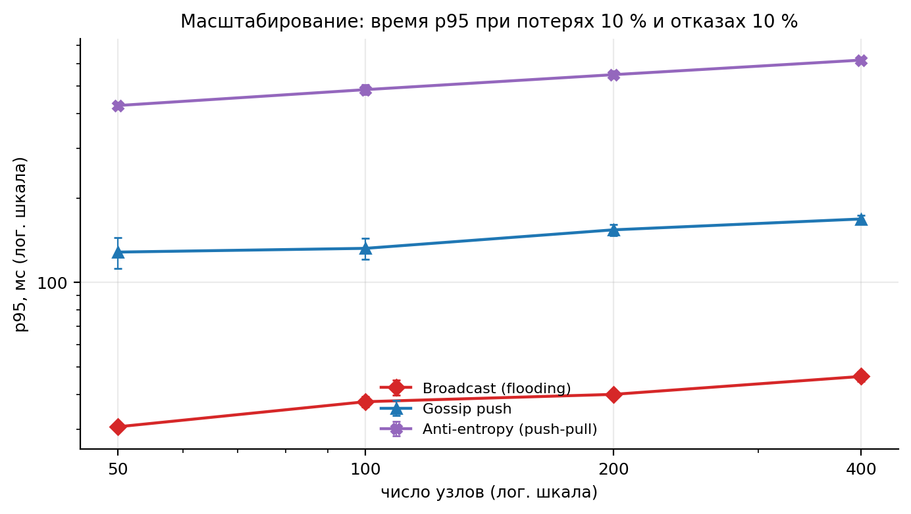

МИНИСТЕРСТВО НАУКИ И ВЫСШЕГО ОБРАЗОВАНИЯ РОССИЙСКОЙ ФЕДЕРАЦИИ

Федеральное государственное автономное образовательное учреждение высшего образования

<b>«Национальный исследовательский университет ИТМО»</b>

Факультет программной инженерии и компьютерной техники

<b>ОТЧЁТ</b>

по лабораторной работе

по дисциплине «Распределённые системы»

<b>«Исследование методов распространения информации в распределённых системах»</b>

Выполнил: студент группы Р4235

Баряев Андрей Алексеевич

&nbsp;

Проверил: Перл Иван Андреевич

Санкт-Петербург 2026

СОДЕРЖАНИЕ

<!--TOC-->

# Введение

Цель работы: построить распределённую систему из более чем 100 узлов, реализовать алгоритмы распространения информации и исследовать, за какое время распространяется сообщение и как на это влияют потери пакетов, отказы узлов и топология.

Исследованы алгоритмы single cast (unicast), multicast, broadcast, gossip (push и pull) и доработки gossip: rumor mongering и anti-entropy (push-pull). Система реализована на Go, узлы упакованы в Docker-контейнеры и обмениваются сообщениями по UDP. Проведено 5040 экспериментов в симуляторе (до 400 узлов) и 210 экспериментов на 110 контейнерах.

# 1. Задание и среда выполнения

Задание: построить систему из 100 и более узлов, которая распространяет информацию по перечисленным алгоритмам; исследовать время распространения и влияние потерь пакетов, отказов узлов и других факторов; технологии выбираются свободно. Выбранный стек: Go (без внешних зависимостей), UDP с JSON, HTTP для управления, Docker.

Таблица 1. Среда выполнения

| Параметр | Значение |
|---|---|
| Компьютер | Apple M4 Pro, 14 ядер, 24 ГБ ОЗУ, macOS 26.6 |
| Docker | Docker Desktop 29.4.3, ядро Linux 6.12 в виртуальной машине (14 vCPU, 16 ГБ) |
| Языки | Go 1.24 (образ узла), Go 1.27 (сборка на хосте), Python 3.9 (графики и отчёт) |

# 2. Модель, метрики и алгоритмы

Система состоит из N узлов. Один узел-источник распространяет одно сообщение. Узел считается информированным после первого полученного пакета данных.

Для каждого алгоритма задано целевое множество получателей. Для unicast это один узел, для multicast группа из 30 % узлов, для остальных алгоритмов все живые узлы, кроме источника. Время p95 это момент, к которому информированы 95 % целевого множества. Покрытие coverage есть доля информированных в целевом множестве, а coverage_total есть доля информированных среди всех узлов, включая отказавшие.

Потери моделируются на отправителе: каждый исходящий пакет отбрасывается с вероятностью p. Отказ узла: прекращение отправки и приёма. Отказ может быть до старта (узел исключается из целевого множества) или в момент 500 мс.

Таблица 2. Алгоритмы

| Алгоритм | Правило работы | Повторы |
|---|---|---|
| Unicast | источник шлёт один пакет одному узлу | нет |
| Multicast | источник шлёт пакет каждому члену группы напрямую | нет |
| Broadcast | каждый узел при первом получении пересылает всем соседям | нет |
| Gossip push | информированный узел каждые 100 мс шлёт данные 3 случайным соседям | до 60 раундов |
| Gossip pull | неинформированный узел каждые 100 мс запрашивает данные у 3 соседей | до 60 раундов |
| Rumor mongering | push с бюджетом 15 раундов; ответ «уже знаю» уменьшает бюджет | бюджет |
| Anti-entropy | каждые 100 мс обмен дайджестами с 3 соседями, данные передаются в ту сторону, где их нет | до 60 раундов |

# 3. Реализация

Общий автомат алгоритмов (пакет `internal/engine`) используется и в симуляторе, и в Docker-агенте. В симуляторе транспорт: очередь событий с виртуальным временем (задержка 5 мс + джиттер 0-5 мс), в Docker: реальный UDP. Агент узла принимает конфигурацию и команды старта по HTTP (`/config`, `/start`, `/fail`, `/reset`, `/state`).

Координатор запускает 110 контейнеров в сети Docker, передаёт каждому узлу карту адресов и проводит прогоны. Для учёта датаграмм агент считает отправленные и принятые пакеты приложения и читает счётчики UDP ядра (`/proc/net/snmp`). Это позволяет отличить заданные потери от потерь внутри сети. Автоматические тесты (`go test`) проверяют связность топологий, доставку без потерь и сходимость алгоритмов при потерях.

# 4. Эксперименты и результаты

Основная серия симулятора: 120 узлов, случайный граф степени 6, 30 seed'ов на каждую точку, потери 0-50 %, отказы 0-30 %. Дополнительно: топологии (ring, full mesh), масштаб (50-400 узлов), авария 20 % узлов в момент 500 мс. Значения даны как среднее по seed'ам с 95 % доверительным интервалом (± полуширина, распределение Стьюдента): n = 30 в симуляторе и n = 5 в Docker. p95 усредняется только по успешным запускам.

## 4.1. Потери пакетов

Таблица 3. Потери пакетов без отказов узлов (симуляция, 120 узлов)

<!--T:loss-->

{: .fig}

Рисунок 1. Время p95 в зависимости от вероятности потери пакета. Планки погрешности: 95 % доверительный интервал.

Алгоритмы с повторами сохраняют полное покрытие при потерях 50 %, но время растёт в 2,7-3,7 раза. Broadcast самый быстрый при малых потерях (35 мс), однако без повторов при потерях 50 % его покрытие снижается до 0,954, а порог 95 % достигается лишь в 93 % запусков. Unicast и multicast без повторов теряют получателей: при потерях 50 % покрытие около 0,5. Порог 95 % для multicast достигается лишь в 13 % запусков уже при потерях 10 %, а при 50 % не достигается никогда: в группе из 36 узлов он допускает потерю не более одного пакета.

{: .fig}

Рисунок 2. Покрытие целевых узлов в зависимости от потерь. Планки погрешности: 95 % доверительный интервал.

## 4.2. Отказы узлов

Таблица 4. Отказ узлов до старта, потери 10 % (симуляция)

<!--T:fail-->

{: .fig}

Рисунок 3. Покрытие всех узлов при отказе доли узлов (потери 10 %); линии алгоритмов с повторами совпадают. Планки погрешности: 95 % доверительный интервал.

Отказавшие узлы не могут получить сообщение, поэтому покрытие всех узлов падает линейно. Покрытие живых узлов у алгоритмов с повторами остаётся на уровне 0,998-1,000. Время растёт у gossip-алгоритмов из-за меньшего числа доступных партнёров; broadcast почти не меняется, так как оставшийся граф связен.

## 4.3. Топология и масштаб

Таблица 5. Топология (потери 10 %, отказы 10 %, p95, мс / сообщений)

<!--T:topology-->

Таблица 6. Масштаб (потери 10 %, отказы 10 %, p95, мс)

<!--T:scale-->

Full mesh ускоряет broadcast до 20 мс, но трафик вырастает в 19 раз. Кольцо делает все gossip-алгоритмы медленными: диаметр кольца при степени 6 около 20 переходов. Время broadcast растёт с числом узлов медленнее всего.

{: .fig}

Рисунок 4. Время p95 в зависимости от числа узлов. Планки погрешности: 95 % доверительный интервал.

## 4.4. Авария во время распространения

Таблица 7. Авария 20 % узлов в момент 500 мс (потери 20 %)

<!--T:crash-->

{: .fig}

Рисунок 5. Покрытие при аварии 20 % узлов в момент 500 мс. Планки погрешности: 95 % доверительный интервал.

Быстрые алгоритмы успевают доставить сообщение до аварии. Медленные (anti-entropy, gossip pull) к моменту аварии охватили не всех, и часть узлов, отказавших раньше получения, остаётся без сообщения.

## 4.5. Проверка на 110 Docker-контейнерах

Серия: 110 контейнеров, 7 алгоритмов, потери 0 / 20 / 40 %, отказы 0 / 20 %, 5 seed'ов: 210 прогонов. Контейнеры пересоздавались перед каждым прогоном.

Таблица 8. Docker, 110 контейнеров (отказов нет, среднее по 5 seed'ам)

<!--T:docker-->

{: .fig}

Рисунок 6. Симуляция и Docker при потерях 20 % и отказах 20 %. Планки погрешности: 95 % доверительный интервал.

Качественные выводы совпадают с симуляцией. Абсолютные времена Docker меньше: в симуляторе задержка 5 мс на переход, а в Docker: доли миллисекунды на одном хосте.

По счётчикам Docker-серии `send_errors` равен нулю во всех 210 прогонах. `kernel_out` совпадает с `kernel_in` в 205 прогонах; в остальных расхождение не превышает 6 датаграмм на границе окна замера. Число датаграмм, посчитанное приложением, меньше `kernel_in` в 12 прогонах (до 183 датаграмм): это трафик gossip-алгоритмов, который продолжается после полного охвата, а состояние узлов снимается раньше счётчиков ядра. Потери, видимые в таблицах, заданы экспериментом.

При повторном использовании одного набора контейнеров в течение долгой серии наблюдалась деградация сети. Например, в диагностическом замере ядро отправило 613 датаграмм, а узлы приняли 561, без ошибок на приёмной стороне. Поэтому итоговая серия выполнена с пересозданием контейнеров перед каждым прогоном.

# 5. Выводы

1. Время распространения различается на порядок: от 35 мс у broadcast до 0,4-1,5 с у gossip pull и anti-entropy при потерях 50 %.
2. Повторы сохраняют полное покрытие при потерях до 50 %, ценой роста времени в 2,7-3,7 раза и трафика. Одноразовые unicast, multicast и broadcast теряют получателей.
3. Отказы до старта снижают покрытие всех узлов линейно; покрытие живых узлов у алгоритмов с повторами сохраняется. Авария во время работы опасна для медленных алгоритмов.
4. Топология и масштаб важны: кольцо замедляет gossip в 4-5 раз, full mesh ускоряет broadcast ценой трафика, broadcast масштабируется лучше всех.

Рекомендации: для надёжной сети с редкими отказами: broadcast; для ненадёжной сети: gossip push или rumor mongering (rumor mongering примерно в 2,5 раза экономичнее anti-entropy); anti-entropy: как фоновый механизм догоняющей синхронизации; multicast и unicast: только с подтверждениями; для gossip избегать кольцевой топологии.

Ограничения: потери моделируются на отправителе; одно сообщение; узлы однородны; multicast: звезда от источника; в Docker 5 seed'ов на точку; абсолютные времена зависят от среды.

# Заключение

Построена распределённая система из 120 логических узлов (до 400 в масштабных экспериментах) и 110 Docker-контейнеров. Реализованы и сравнены семь алгоритмов распространения информации. Результаты подтверждают, что выбор алгоритма определяется соотношением между скоростью, устойчивостью к потерям и трафиком: нет алгоритма, оптимального по всем трём критериям.

# Список использованных источников

1. Demers A. et al. Epidemic algorithms for replicated database maintenance // Proc. PODC '87. New York: ACM, 1987. P. 1-12.
2. Eugster P. T., Guerraoui R., Kermarrec A.-M., Massoulié L. Epidemic information dissemination in distributed systems // Computer. 2004. Vol. 37, No. 5. P. 60-67.
3. Kermarrec A.-M., van Steen M. Gossiping in distributed systems // ACM SIGOPS Operating Systems Review. 2007. Vol. 41, No. 5. P. 2-7.
4. Tanenbaum A. S., van Steen M. Distributed Systems: Principles and Paradigms. 2nd ed. Pearson Prentice Hall, 2007.
5. ip(7). Linux Programmer's Manual (опция IP_RECVERR). URL: https://man7.org/linux/man-pages/man7/ip.7.html
6. Docker Documentation. URL: https://docs.docker.com/

# Приложение. Воспроизведение

Из корня репозитория: `make test` (тесты), `make sim` (симуляция, около 10 с), `make figures` (рисунки), `make docker` (110 контейнеров, около 80 мин), `make report` (PDF и DOCX). Данные лежат в `results/`.
