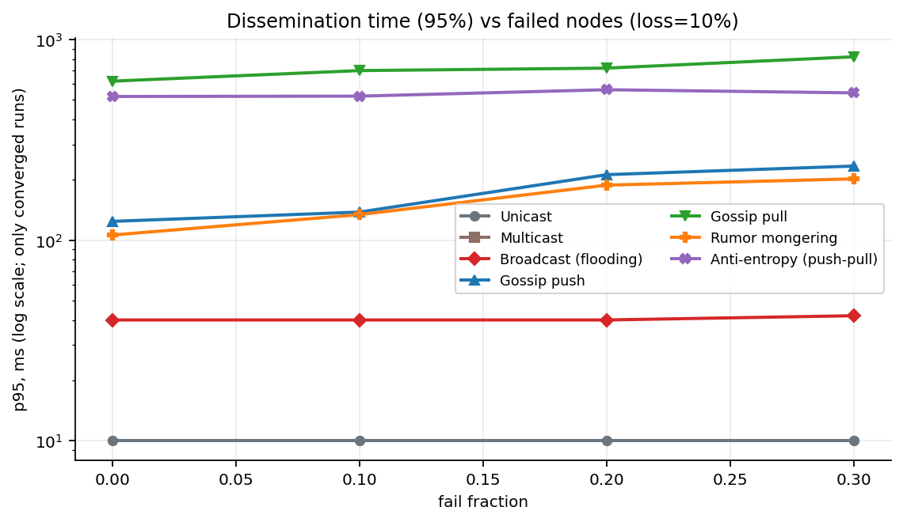
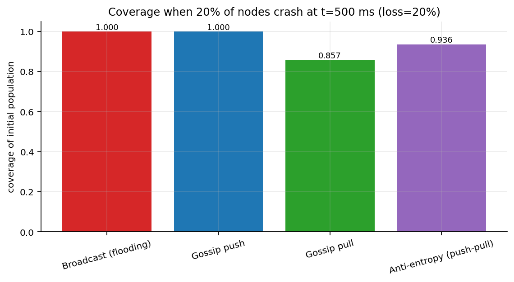
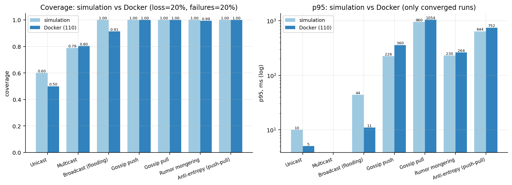

# Распространение информации в распределённых системах: unicast, multicast, broadcast и gossip

**Лабораторная работа**

Выполнил: студент (GitHub: [AndrewTheMaster](https://github.com/AndrewTheMaster))  
Преподаватель: Перл Иван Андреевич  
Дата: 14 ноября 2026 г.

---

## Аннотация

В работе реализована распределённая система из 120 логических узлов (и до 400 узлов в экспериментах масштабирования), в которой сравниваются семь стратегий распространения одного сообщения: *unicast*, *multicast*, *broadcast* (flooding), *gossip push*, *gossip pull*, *rumor mongering* и *anti-entropy* (push-pull). Для управления экспериментами и сбора метрик использован собственный координатор на Go; проверка на реальной инфраструктуре выполнена на **110 Docker-контейнерах**.

Исследовано, как на время и полноту распространения влияют потери пакетов (0–50 %), отказы узлов (0–30 %), топология сети (random, ring, full mesh), масштаб (50–400 узлов) и отказ узлов непосредственно во время распространения. Всего проведено **784 симуляционных прогона** и **84 прогона на Docker-контейнерах**.

Основные результаты:

* *broadcast* — самый быстрый при малых потерях (p95 ≈ 38 мс), но не имеет повторных передач и деградирует при потерях и отказах;
* *gossip push* — лучший компромисс «скорость/надёжность»: p95 110 → 380 мс при росте потерь с 0 до 50 %, покрытие 100 %;
* *anti-entropy* — самый надёжный и устойчивый к потерям, но самый дорогой по числу сообщений (≈ 2,2–2,5 тыс. сообщений на 120 узлов) и медленный;
* *multicast* без подтверждений и повторов быстро теряет покрытие: 87 % при 10 % потерь и 48 % при 50 %;
* при отказе 20 % узлов в момент t = 500 мс быстрые алгоритмы успевают доставить сообщение всем живым узлам, а медленный *gossip pull* — только 85,7 %;
* в Docker-окружении одноразовый *broadcast* терял 3–8 % узлов даже при «нулевых» настройках потерь из-за фоновых потерь UDP в bridge-сети, тогда как gossip-алгоритмы за счёт повторов достигали покрытия, близкого к 100 %.

---

## 1. Цель и задачи

**Цель:** исследовать методы распространения информации в распределённой системе из 100+ узлов и количественно сравнить их по времени распространения, полноте охвата и устойчивости к потерям пакетов и отказам узлов.

**Задачи:**

1. Реализовать систему из 100+ узлов с единым протоколом обмена сообщениями.
2. Реализовать алгоритмы *unicast*, *multicast*, *broadcast*, *gossip push*, *gossip pull*, *rumor mongering* и *anti-entropy*.
3. Реализовать управляемое внесение потерь пакетов и отказов узлов.
4. Провести серию экспериментов с разными потерями, долей отказавших узлов, топологиями и масштабом.
5. Проверить результаты на реальных Docker-контейнерах (110 узлов).
6. Построить графики, таблицы и сделать выводы о применимости алгоритмов.

---

## 2. Модель системы и метрики

### 2.1. Модель

Система состоит из $N$ узлов. Один узел-источник $s$ инициирует распространение одного сообщения с уникальным `message_id`. Каждый узел хранит:

* факт получения сообщения (`informed`);
* время первого получения (`first_seen`);
* счётчики отправленных, полученных, потерянных и дублирующих пакетов.

Узел считается **информированным**, если он получил хотя бы один пакет данных с этим `message_id`. Повторные пакеты увеличивают счётчик дублей, но не меняют `first_seen`.

Для каждого алгоритма определено **целевое множество** (intended set):

* *unicast* — один выбранный получатель;
* *multicast* — группа из 30 % узлов (без источника);
* *broadcast*, *gossip*, *rumor*, *anti-entropy* — все узлы, живые на момент старта, кроме источника.

Вводятся две метрики покрытия:

* `coverage_intended` — доля информированных узлов среди целевого множества;
* `coverage_total` — доля информированных среди всех $N-1$ узлов, кроме источника (позволяет увидеть «цену» отказов: мёртвые узлы не могут получить сообщение).

### 2.2. Время распространения

Пусть $F(t)$ — число информированных узлов целевого множества к моменту $t$. Тогда время достижения порога $q$:

$$
T_q = \min \{ t \mid F(t) \ge q \cdot |\text{intended}| \}.
$$

В работе используются $T_{0.5}, T_{0.9}, T_{0.95}, T_{0.99}, T_{1.0}$. Основная метрика — **p95 = $T_{0.95}$**. Если порог не достигнут за время эксперимента, значение помечается как `-1`, а в сводных таблицах для p95 учитываются только успешные запуски; дополнительно приводится `reach95` — доля запусков, в которых порог 95 % был достигнут.

### 2.3. Потери и отказы

**Потери пакетов** моделируются на уровне приложения: каждый исходящий пакет с вероятностью $p$ не отправляется (считается потерянным). Это эквивалентно работе поверх ненадёжного UDP и позволяет отделить потери от задержек и перегрузки. В симуляторе задержка одного перехода — 5 мс плюс случайный джиттер 0–5 мс; в Docker используется реальная сеть контейнеров.

**Отказ узла** означает, что узел перестаёт отправлять и принимать пакеты. Рассматриваются два сценария:

1. отказ доли узлов **до старта** (они исключаются из целевого множества, но входят в `coverage_total`);
2. **авария во время распространения** — доля узлов отказывает в момент $t = 500$ мс; целевое множество включает их, поэтому покрытие показывает, успело ли сообщение дойти до них до отказа.

### 2.4. Накладные расходы

Дополнительно измеряется число сообщений, отправленных всеми узлами за эксперимент (`messages_sent`), число дублей (`duplicates`) и потерянных пакетов (`dropped`). Это позволяет сравнить не только скорость, но и «цену» алгоритма.

---

## 3. Алгоритмы

### 3.1. Unicast

Источник отправляет ровно один пакет данных одному выбранному узлу. Повторов и подтверждений нет. Покрытие целевого множества — 1 узел; `coverage_total` по определению мала (≈ $1/N$). Это базовая точка отсчёта для задержки и потерь.

### 3.2. Multicast

Источник отправляет пакет каждому члену группы (30 % узлов) напрямую, без пересылки через промежуточные узлы. Получатели не пересылают сообщение дальше. Это простейший вариант прикладного multicast «звездой». При потерях и отказах без подтверждений и повторных передач часть группы остаётся неинформированной.

### 3.3. Broadcast (flooding)

Источник отправляет сообщение всем соседям. Каждый узел, впервые получивший сообщение, пересылает его всем своим соседям, кроме отправителя. Повторно полученные пакеты отбрасываются (duplicate suppression). Пересылка выполняется один раз, без повторных передач. В связном графе сообщение достигает всех живых узлов за число шагов, равное диаметру графа, но при потерях отдельные ветви «обрываются».

### 3.4. Gossip push

Каждый информированный узел периодически (раз в 100 мс) выбирает $f = 3$ случайных соседа и отправляет им сообщение. Узел, впервые получивший сообщение, начинает участвовать в рассылке. Максимум — 60 раундов. Повторы компенсируют потери; скорость определяется скоростью «эпидемии» и fanout.

### 3.5. Gossip pull

Неинформированные узлы периодически выбирают $f = 3$ случайных соседа и отправляют им запрос `pull`. Информированный сосед отвечает пакетом данных. Узел, получивший данные, перестаёт опрашивать. Алгоритм устойчив к потерям, но требует больше времени на «запуск эпидемии» и даёт больше задержку в хвосте.

### 3.6. Rumor mongering

Упрощённый gossip push с бюджетом: узел, получивший новость, делает до `rumor_budget` = 15 раундов рассылки по $f = 3$ соседям. Если получатель уже знает новость, он отправляет `stale`-ответ, который уменьшает бюджет отправителя. Такой механизм позволяет раньше остановить распространение «слуха», когда новость уже широко известна, и снизить число сообщений.

### 3.7. Anti-entropy (push-pull)

Каждый узел периодически (раз в 100 мс) отправляет $f = 3$ случайным соседям дайджест `digest` с информацией, знает ли он сообщение. Возможны три исхода:

* отправитель знает, получатель нет → получатель отправляет `pull`, отправитель отвечает данными;
* получатель знает, отправитель нет → получатель сразу отправляет данные;
* оба знают или оба не знают → обмен завершается без передачи данных.

Периодические дайджесты и двусторонний обмен делают алгоритм наиболее устойчивым к потерям, но самым дорогим по числу служебных сообщений.

---

## 4. Архитектура и реализация

### 4.1. Технологический стек

* **Go 1.24+** — без внешних зависимостей;
* **UDP + JSON** — плоскость данных;
* **HTTP** — плоскость управления (`/config`, `/start`, `/reset`, `/fail`, `/state`, `/health`);
* **Docker** — упаковка узлов и проверка на 110 контейнерах;
* **Python 3 + pandas + matplotlib** — агрегация результатов и графики.

### 4.2. Компоненты

```
cmd/node/            — агент узла (UDP + HTTP)
cmd/lab/             — координатор экспериментов (sim / docker / clean)
internal/engine/     — общий автомат алгоритмов и метрики
internal/sim/        — симулятор с виртуальным временем и очередью событий
internal/agent/      — сетевой агент Docker-узла
internal/dockerlab/  — запуск контейнеров и проведение экспериментов
scripts/analyze.py   — графики и сводные таблицы
scripts/build_report.py — сборка HTML/PDF отчёта
```

Ключевое решение: **один и тот же автомат алгоритмов** (`internal/engine`) используется и в симуляторе, и в Docker-агенте. Симулятор подменяет транспорт очередью событий с виртуальным временем, Docker-агент — реальным UDP. Это позволяет сравнивать результаты и быть уверенным, что различия вызваны средой, а не разной логикой.

### 4.3. Docker-развёртывание

Координатор:

1. собирает образ `ds-lab-node:latest`;
2. создаёт сеть `dslab-net`;
3. запускает 110 контейнеров `dslab-node-000 … dslab-node-109`;
4. публикует управляющие HTTP-порты `127.0.0.1:18000…18109`;
5. определяет IP-адреса контейнеров через `docker inspect` и передаёт каждому узлу карту `id → IP:9000` (это исключает потери из-за DNS-резолвинга);
6. перед каждым прогоном рассылает `/reset`, затем `/config` (топология, группа, потери, fanout), затем `/fail` для отказавших узлов и `/start` с единым `started_at` в будущем, чтобы все узлы успели вооружиться;
7. опрашивает `/state` и собирает `first_seen` и счётчики;
8. после прогона очищает контейнеры (если не указан `--keep`).

### 4.4. Воспроизводимость

Все генераторы случайности инициализируются seed'ом. Для одного и того же seed и $N$ топология, группа multicast и множество отказавших узлов воспроизводятся. Результаты сохраняются в CSV; полные таблицы — в `docs/generated/tables.md`.

---

## 5. Методика экспериментов

### 5.1. Основная матрица (симуляция)

| Параметр | Значение |
|---|---|
| Узлов | 120 |
| Топология | random (кольцо + случайные рёбра до степени 6) |
| Степень графа | 6 |
| Seed'ы | 1–5 |
| Алгоритмы | 7 |
| Потери | 0, 0.1, 0.2, 0.3, 0.5 |
| Доля отказавших узлов до старта | 0, 0.1, 0.2, 0.3 |
| Задержка / джиттер | 5 мс / 0–5 мс |
| Gossip fanout | 3 |
| Интервал gossip | 100 мс |
| Максимум раундов | 60 |
| Таймаут | 8000 мс |
| Шаг симуляции | 10 мс |

Итого $7 \cdot 5 \cdot 4 \cdot 5 = 700$ прогонов.

### 5.2. Дополнительные серии

* **Топология:** random / ring / full, 120 узлов, loss = 0.1, failures = 0.1, 3 seed'а, 4 алгоритма — 36 прогонов.
* **Масштаб:** 50 / 100 / 200 / 400 узлов, loss = 0.1, failures = 0.1, 3 seed'а, 3 алгоритма — 36 прогонов.
* **Авария во время распространения:** 120 узлов, loss = 0.2, 20 % узлов отказывают в t = 500 мс, 3 seed'а, 4 алгоритма — 12 прогонов.

### 5.3. Проверка на Docker

110 контейнеров, 7 алгоритмов, потери 0 / 0.2 / 0.4, отказы 0 / 0.2, 2 seed'а — **84 прогона**. В Docker-экспериментах отказы моделируются до старта; дополнительная авария во время распространения исследована в симуляторе.

### 5.4. Обработка p95

При потерях и отказах часть запусков не достигает порога 95 %. Если усреднять `-1` вместе с временами, получаются бессмысленные значения. Поэтому в таблицах:

* `p95` — среднее только по запускам, где порог 95 % достигнут;
* `reach95` — доля таких запусков.

Например, `p95 = 380 мс, reach95 = 1.0` означает, что во всех запусках 95 % узлов были охвачены в среднем за 380 мс. `p95 = —, reach95 = 0` означает, что порог не достигался ни разу.

---

## 6. Результаты

### 6.1. Влияние потерь пакетов


*Рис. 1. Время достижения 95 % целевого множества в зависимости от вероятности потери пакета (120 узлов, отказов нет).*


*Рис. 2. Покрытие целевого множества в зависимости от потерь.*

Ключевые значения при отсутствии потерь и при 50 % потерь:

| Алгоритм | p95, 0 % | p95, 50 % | coverage, 0 % | coverage, 50 % | Сообщений, 0 % | Сообщений, 50 % |
|---|---:|---:|---:|---:|---:|---:|
| unicast | 10 мс | 10 мс | 1.000 | 0.400 | 1 | 0.4 |
| multicast | 10 мс | — | 1.000 | 0.478 | 36 | 17 |
| broadcast | 38 мс | 58 мс | 1.000 | 0.988 | 737 | 366 |
| gossip push | 110 мс | 380 мс | 1.000 | 1.000 | 741 | 714 |
| gossip pull | 540 мс | 1720 мс | 1.000 | 1.000 | 1546 | 2308 |
| rumor mongering | 110 мс | 362 мс | 1.000 | 1.000 | 1220 | 959 |
| anti-entropy | 422 мс | 1142 мс | 1.000 | 1.000 | 2199 | 2473 |

Выводы:

* **Broadcast** вне конкуренции по скорости при малых потерях: 38 мс против 110 мс у gossip push. Но это одноразовая лавина: при 50 % потерь покрытие падает до 98,8 %, а отдельные запуски не достигают 95 % порога.
* **Gossip push** и **rumor mongering** сохраняют покрытие 100 % при 50 % потерь, увеличивая p95 до 380 и 362 мс соответственно. Rumor делает это примерно на 60 % меньшим числом сообщений, чем anti-entropy, за счёт обратной связи `stale`.
* **Anti-entropy** также сохраняет 100 % покрытие, но платит за это задержкой (1142 мс при 50 % потерь) и наибольшим числом сообщений (≈ 2,5 тыс. на 120 узлов).
* **Gossip pull** — самый медленный: 540 мс уже без потерь и 1720 мс при 50 %. Причина — необходимость «дождаться», пока неинформированный узел сам кого-то опросит.
* **Unicast** и **multicast** без повторных передач ожидаемо деградируют: один потерянный пакет — потерянный получатель. Для multicast при 10 % потерь покрытие группы 87 %, при 50 % — 48 %.


*Рис. 3. Число отправленных сообщений в зависимости от потерь.*

### 6.2. Влияние отказавших узлов



*Рис. 4. Время p95 при отказе доли узлов до старта (loss = 10 %).*


*Рис. 5. Покрытие всех узлов, кроме источника, при отказах (loss = 10 %).*

При 30 % отказавших узлов и 10 % потерь:

| Алгоритм | p95, 0 % отказов | p95, 30 % отказов | coverage_intended, 30 % | coverage_total, 30 % |
|---|---:|---:|---:|---:|
| broadcast | 40 мс | 42 мс | 1.000 | 0.697 |
| gossip push | 124 мс | 234 мс | 1.000 | 0.697 |
| rumor mongering | 106 мс | 202 мс | 1.000 | 0.697 |
| anti-entropy | 520 мс | 542 мс | 1.000 | 0.697 |
| gossip pull | 620 мс | 820 мс | 1.000 | 0.697 |
| multicast | — | — | 0.863 | 0.190 |
| unicast | 10 мс | 10 мс | 1.000 | 0.008 |

Наблюдения:

* Отказ узлов **до старта** не мешает retry-алгоритмам доставить сообщение живым узлам: `coverage_intended` остаётся 1.000. Но `coverage_total` линейно падает: при 30 % отказов только 69,7 % всех узлов (включая мёртвые) могут получить сообщение — это ожидаемая «цена» отказов.
* Время распространения растёт, потому что выпавшие узлы уменьшают связность и число доступных путей: gossip push 124 → 234 мс, gossip pull 620 → 820 мс, rumor 106 → 202 мс.
* Broadcast почти не меняет p95 (40 → 42 мс), так как оставшийся граф степени 6 остаётся связным; но при более агрессивных отказах или разреженных топологиях возможны разрывы.
* Multicast без повторов страдает дважды: потери плюс отказы; `coverage_total` падает до 0.190 при 30 % отказов.
* Unicast нечувствителен к отказам, потому что получатель выбирается из живых узлов; его `coverage_total` мала по определению.

### 6.3. Влияние топологии


*Рис. 6. Покрытие и p95 для топологий random, ring и full mesh (120 узлов, loss = 10 %, failures = 10 %).*

| Алгоритм | random p95 | ring p95 | full p95 | random сообщений | ring сообщений | full сообщений |
|---|---:|---:|---:|---:|---:|---:|
| broadcast | 40 мс | 223 мс | 20 мс | 594 | 488 | 11 476 |
| gossip push | 127 мс | 467 мс | 153 мс | 518 | 1074 | 536 |
| anti-entropy | 527 мс | 2657 мс | 420 мс | 1927 | 8462 | 1562 |
| gossip pull | 687 мс | 3153 мс | 587 мс | 1456 | 4867 | 1402 |

Выводы:

* **Full mesh** минимизирует задержку (broadcast 20 мс, anti-entropy 420 мс), но broadcast в полном графе отправляет ≈ 11,5 тыс. сообщений — почти в 20 раз больше, чем в random. Это классический компромисс «задержка против трафика».
* **Ring** — худший вариант для всех алгоритмов: диаметр $N/2$, поэтому broadcast 223 мс, gossip push 467 мс, anti-entropy 2657 мс. Anti-entropy в кольце генерирует 8462 сообщения — в 4,4 раза больше, чем в random.
* **Random graph степени 6** — хороший компромисс: близкая к full mesh связность при умеренном трафике.

### 6.4. Масштабирование


*Рис. 7. p95 при увеличении числа узлов (loss = 10 %, failures = 10 %).*

| Алгоритм | 50 узлов | 100 | 200 | 400 | Сообщений на 400 |
|---|---:|---:|---:|---:|---:|
| broadcast | 30 мс | 33 мс | 40 мс | 47 мс | 2009 |
| gossip push | 110 мс | 127 мс | 177 мс | 177 мс | 2492 |
| anti-entropy | 393 мс | 457 мс | 530 мс | 653 мс | 8121 |

* Broadcast растёт медленно (30 → 47 мс), потому что диаметр random-графа растёт как $O(\log N)$; трафик — $\approx 2N$.
* Gossip push выходит на плато 177 мс при 200–400 узлах; трафик растёт примерно как $O(N \log N)$.
* Anti-entropy растёт быстрее (393 → 653 мс) и требует больше всего сообщений — 8121 на 400 узлов, то есть ≈ 20 сообщений на узел.

### 6.5. Авария во время распространения



*Рис. 8. Покрытие при отказе 20 % узлов в t = 500 мс (loss = 20 %).*

| Алгоритм | coverage_intended | p95 | reach95 |
|---|---:|---:|---:|
| broadcast | 1.000 | 40 мс | 1.000 |
| gossip push | 1.000 | 167 мс | 1.000 |
| anti-entropy | 0.936 | 530 мс | 0.333 |
| gossip pull | 0.857 | — | 0.000 |

Этот эксперимент показывает важность **скорости до аварии**. Broadcast и gossip push успевают доставить сообщение всем узлам до t = 500 мс, поэтому авария не снижает покрытие. Anti-entropy к моменту аварии охватил не все узлы; отказавшие до получения узлы уже не могут быть информированы, поэтому покрытие 93,6 %, и только в 1/3 запусков достигается 95 %. Gossip pull — самый медленный, поэтому теряет 14,3 % целевого множества.

### 6.6. Динамика покрытия во времени


*Рис. 9. Рост покрытия во времени для broadcast, gossip push и anti-entropy (120 узлов, loss = 20 %, failures = 10 %, seed = 1).*

Broadcast даёт почти вертикальный фронт: основная масса узлов информируется за 30–60 мс. Gossip push растёт ступенями (раунды по 100 мс) и выходит на 100 % за 200–400 мс. Anti-entropy имеет более пологий ступенчатый фронт и завершает охват позже — за счёт периодических дайджестов и повторных попыток.

### 6.7. Проверка на 110 Docker-контейнерах



*Рис. 10. Симуляция и 110 реальных Docker-контейнеров при loss = 20 %, failures = 20 %.*

Основные результаты Docker-серии:

| Алгоритм | coverage (loss 0) | p95 (loss 0) | coverage (loss 40 %) | p95 (loss 40 %) |
|---|---:|---:|---:|---:|
| unicast | 1.000 | 6 мс | 0.500 | 3 мс |
| multicast | 1.000 | 4 мс | 0.606 | — |
| broadcast | 0.972 | 13 мс | 0.927 | 7 мс |
| gossip push | 1.000 | 161 мс | 1.000 | 460 мс |
| gossip pull | 1.000 | 553 мс | 1.000 | 1509 мс |
| rumor mongering | 1.000 | 116 мс | 1.000 | 416 мс |
| anti-entropy | 0.995 | 357 мс | 1.000 | 1003 мс |

Наблюдения:

* Retry-алгоритмы (gossip push/pull, rumor, anti-entropy) на реальных контейнерах сохраняют покрытие, близкое к 100 %, и демонстрируют тот же рост задержки с потерями, что и симуляция.
* **Broadcast в Docker терял 3–8 % узлов даже при `loss = 0`**. Причина — фоновые потери UDP-датаграмм в bridge-сети Docker Desktop и эффекты первого контакта (ARP, очереди veth). Это хорошая иллюстрация того, что «нулевые потери» в приложении не означают идеальной сети. Gossip-алгоритмы компенсируют эти потери повторными передачами.
* **Multicast** без подтверждений: 100 % при `loss = 0`, 77,3 % при 20 % и 60,6 % при 40 % потерь. p95 не достигается, потому что хотя бы один потерянный пакет из группы ломает 95 %-й порог.
* **Unicast** при 20–40 % потерь даёт покрытие 0,5 (в двух seed'ах один пакет дошёл, один потерялся) — наглядно показывает, почему для одного получателя нужны подтверждения/повторы.
* **Anti-entropy** в одном из запусков без потерь показал «хвост»: 99 % узлов за 506 мс, но последний узел — только к 5,2 с, что дало ≈ 20 тыс. сообщений. Это известная проблема хвостовой задержки gossip: редкие пары «не встретились» достаточно долго.
* В Docker `send_errors = 0` во всех 84 прогонах: потери происходили на уровне сети, а не из-за ошибок разрешения адресов или сокетов.

---

## 7. Обсуждение

### 7.1. Сравнение алгоритмов

| Критерий | Победитель | Комментарий |
|---|---|---|
| Минимальная задержка | broadcast | 38 мс в симуляции, 13 мс в Docker; но только при малых потерях |
| Устойчивость к потерям | anti-entropy | 100 % при 50 % потерь; цена — задержка и трафик |
| Лучший компромисс | gossip push / rumor | 100 % при 50 % потерях, p95 362–380 мс, умеренный трафик |
| Минимум трафика | unicast / multicast | но покрытие ограничено целевым множеством |
| Устойчивость к авариям во время работы | broadcast / gossip push | успевают доставить до отказа |
| Худшая задержка | gossip pull | 540 мс без потерь, 1720 мс при 50 % |
| Худшая устойчивость без повторов | unicast / multicast | один потерянный пакет = потерянный получатель |

### 7.2. Практические рекомендации

1. **Надёжная локальная сеть, мало отказов, нужна минимальная задержка** — broadcast (flooding) с ограничением TTL и дублей.
2. **Ненадёжная сеть, 100+ узлов, нужна гарантированная доставка** — anti-entropy; закладывать время на хвост и трафик.
3. **Нужен баланс скорости и надёжности** — gossip push или rumor mongering; fanout 3 и интервал 100 мс дают хороший результат.
4. **Групповая рассылка** — multicast, но с подтверждениями и повторными передачами; в текущей реализации без них multicast быстро теряет покрытие.
5. **Один получатель** — unicast с подтверждением/повтором; «сырой» unicast поверх UDP ненадёжен.
6. **Топология** — избегать колец для gossip/anti-entropy; random graph степени 6 близок к full mesh по задержке при несопоставимо меньшем трафике.

### 7.3. Ограничения

* Потери моделируются на уровне приложения (sender-side drop), а не физического канала; в Docker добавляются реальные фоновые потери.
* Рассылается одно сообщение; нет конкурирующих обновлений и версионирования.
* Узлы однородны, нет Byzantine-отказов и злонамеренного поведения.
* Multicast реализован «звездой» от источника, без построения дерева и без подтверждений.
* Отказы мгновенные; нет постепенной деградации и восстановления.
* p95 усредняется по seed'ам; для строгой оценки хвоста нужны квантили по большему числу запусков.
* Docker Desktop на macOS добавляет собственные сетевые эффекты; результаты на Linux-хосте могут отличаться.

### 7.4. Направления развития

* Добавить ACK/retransmit и сравнить «надёжный broadcast» с gossip.
* Реализовать multicast-дерево и сравнить с flooding.
* Добавить адаптивный fanout и интервал в зависимости от потерь.
* Использовать Merkle-дайджесты для anti-entropy при нескольких сообщениях.
* Провести эксперименты на 500+ контейнерах и на нескольких физических хостах.
* Добавить chaos-тесты: случайные паузы, перезапуски, сетевые задержки и переупорядочивание.

---

## 8. Заключение

В работе построена система из 120 логических узлов и 110 реальных Docker-контейнеров, реализованы и количественно сравнены семь методов распространения информации. Проведено 868 экспериментов (784 симуляционных и 84 на Docker).

Главный вывод: **не существует одного лучшего алгоритма**. Broadcast быстрее всех, но хрупок; anti-entropy надёжнее всех, но дорог и медленен; gossip push и rumor mongering дают лучший практический компромисс. Потери пакетов и отказы узлов по-разному влияют на алгоритмы: retry-алгоритмы сохраняют покрытие, но растёт задержка; одноразовые алгоритмы теряют покрытие. Топология и масштаб также существенны: кольцо резко ухудшает gossip/anti-entropy, а full mesh ускоряет broadcast ценой квадратичного трафика. Аварии во время распространения наказывают медленные алгоритмы: к моменту отказа anti-entropy и gossip pull ещё не успевают охватить всех.

Полученные результаты согласуются с теорией эпидемических протоколов и показывают, что для распределённой системы 100+ узлов разумно комбинировать быстрый начальный broadcast/gossip push с периодической anti-entropy для гарантированного «догоняющего» распространения.

---

## 9. Воспроизведение

```bash
# 1. Сборка и тесты
go build ./...
go test ./...

# 2. Симуляционные эксперименты (≈ 1–2 минуты)
make sim

# 3. Графики и таблицы
make figures

# 4. Проверка на 110 Docker-контейнерах (≈ 6–7 минут)
make docker

# 5. Сборка отчёта (HTML + PDF)
make report
```

Полные таблицы: [`docs/generated/tables.md`](generated/tables.md).  
Исходные данные: `results/sim_main.csv`, `results/sim_topology.csv`, `results/sim_scale.csv`, `results/sim_crash.csv`, `results/docker_main.csv`, `results/timeline.csv`.

---

## Приложение. Схема CSV

| Колонка | Смысл |
|---|---|
| `mode` | `sim` или `docker` |
| `experiment_id` | идентификатор прогона |
| `algorithm` | алгоритм |
| `nodes` | число узлов |
| `topology` | топология |
| `degree` | целевая степень графа |
| `loss` | вероятность потери пакета |
| `fail_fraction` | доля отказавших узлов |
| `fail_at_ms` | время аварии (0 — отказ до старта) |
| `seed` | seed генератора |
| `group_size` | размер multicast-группы |
| `alive_nodes` | число живых узлов на старте |
| `intended` | размер целевого множества |
| `informed_intended` | число информированных в целевом множестве |
| `coverage_intended` | покрытие целевого множества |
| `coverage_total` | покрытие всех узлов, кроме источника |
| `dissemination_ms_50/90/95/99/100` | время достижения порога, мс (−1 = не достигнут) |
| `messages_sent` | число отправленных сообщений |
| `messages_received` | число полученных сообщений |
| `duplicates` | число повторно полученных пакетов |
| `dropped` | число потерянных пакетов (модель потерь) |
| `send_errors` | ошибки отправки (сокет/адрес) |
| `elapsed_ms` | время до последнего первого получения |
| `converged` | достигнуто ли 100 % целевого множества |
| `timed_out` | не достигнуто ли 100 % |
