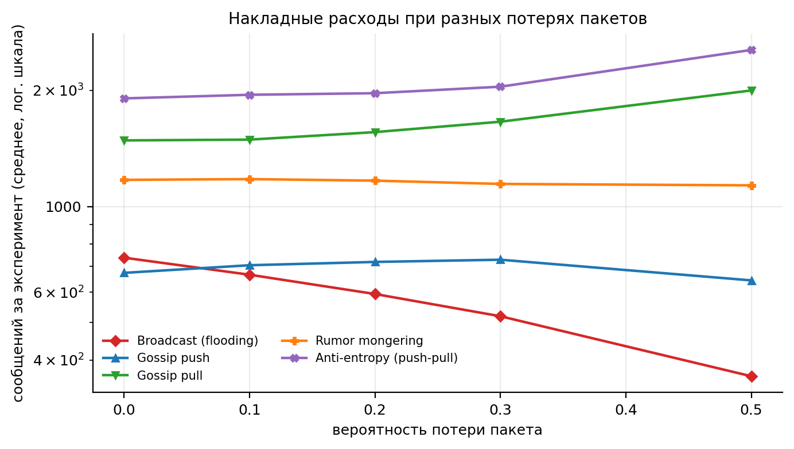
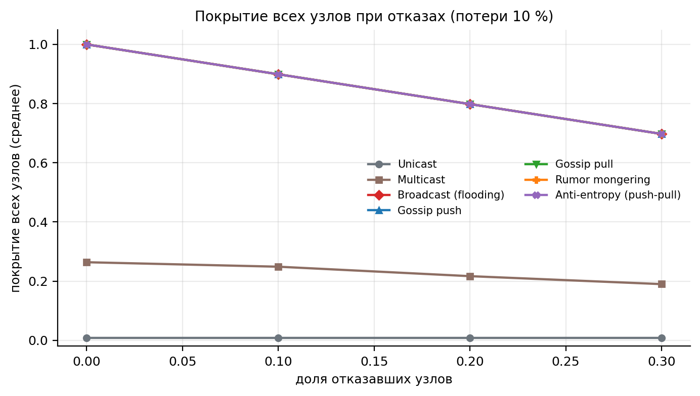
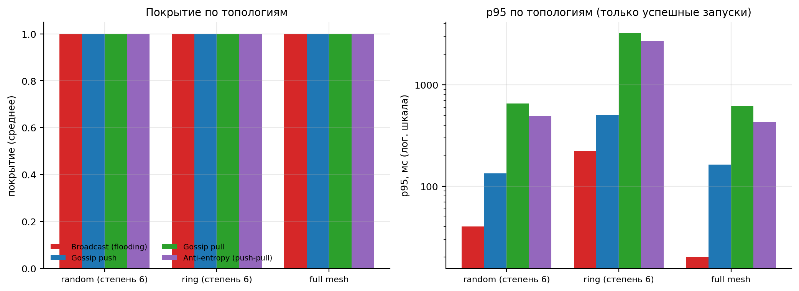
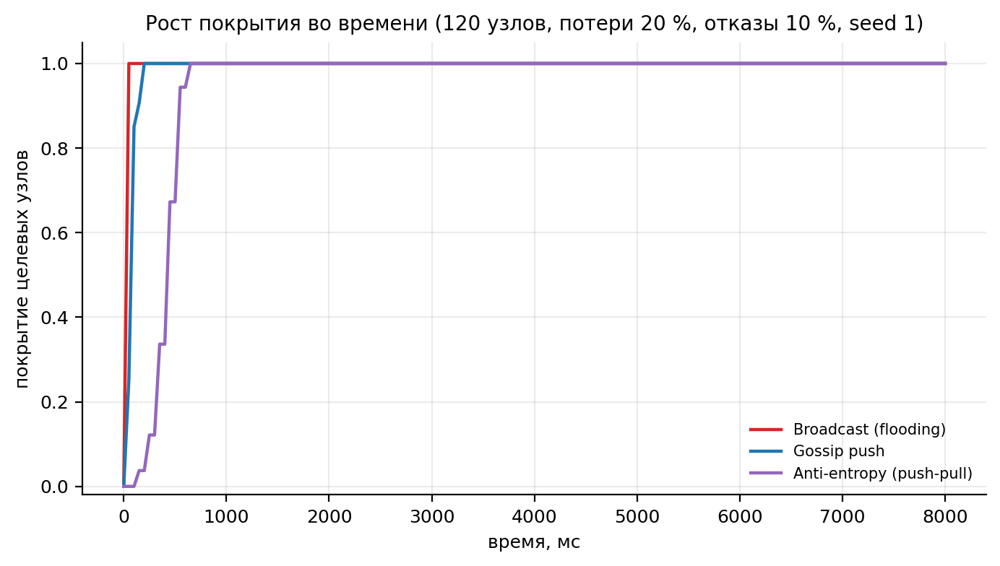

<div class="titlepage">
<p class="ministry">МИНИСТЕРСТВО НАУКИ И ВЫСШЕГО ОБРАЗОВАНИЯ РОССИЙСКОЙ ФЕДЕРАЦИИ</p>
<p class="ministry">Федеральное государственное автономное образовательное учреждение высшего образования</p>
<p class="ministry"><b>«Национальный исследовательский университет ИТМО»</b></p>
<p class="ministry">Факультет программной инженерии и компьютерной техники</p>
<p class="ttl"><b>ОТЧЁТ</b></p>
<p class="center">по лабораторной работе</p>
<p class="center">по дисциплине «Распределённые системы»</p>
<p class="center"><b>«Исследование методов распространения информации в распределённых системах»</b></p>
<div class="sign">
<p>Выполнил: студент группы Р4235</p>
<p>Баряев Андрей Алексеевич</p>
<p>&nbsp;</p>
<p>Проверил: Перл Иван Андреевич</p>
</div>
<p class="city">Санкт-Петербург<br>2026</p>
</div>

<div class="pagebreak"></div>

<div class="toc-title">СОДЕРЖАНИЕ</div>

<!--TOC-->

<div class="pagebreak"></div>

# Введение

Цель работы — исследовать методы распространения информации в распределённой системе из более чем 100 узлов и количественно сравнить их по времени распространения, полноте охвата и устойчивости к потерям пакетов, отказам узлов и другим возмущениям.

Задачи работы:

1. Построить распределённую систему из 100 и более узлов с общим протоколом обмена сообщениями и упаковать узлы в Docker-контейнеры.
2. Реализовать алгоритмы адресной рассылки и рассылки типа «эпидемия»: single cast (unicast), multicast, broadcast (лавинная рассылка), gossip (push и pull), а также доработки gossip — rumor mongering и anti-entropy (push-pull).
3. Реализовать управляемое внесение потерь пакетов, отказов узлов и аварий во время распространения.
4. Провести серии экспериментов: в симуляторе — при 120 и до 400 узлах, в Docker — на 110 контейнерах.
5. Измерить время распространения, покрытие, число сообщений и устойчивость каждого алгоритма, проанализировать влияние потерь, отказов, топологии и масштаба.
6. Оформить результаты в виде отчёта и проекта в репозитории.

Объектом исследования являются алгоритмы распространения информации в распределённых системах. Предметом исследования — зависимость времени и полноты распространения от параметров среды (потери пакетов, доля отказавших узлов, момент аварии, топология, число узлов).

Основные результаты: broadcast — самый быстрый при малых потерях (p95 ≈ 40 мс), но без повторных передач не выдерживает потерь; gossip push даёт лучший баланс скорости и надёжности (покрытие 100 % при потерях до 50 %, p95 от 100 до 348 мс); anti-entropy — самый надёжный, но самый дорогой по числу сообщений; multicast и unicast без подтверждений быстро теряют покрытие. В Docker-окружении при длительном использовании одного набора контейнеров наблюдались потери датаграмм, которые не задавались экспериментом; они измерены по счётчикам ядра Linux, а итоговая серия выполнена с пересоздаваемыми контейнерами, где таких потерь не было.

# 1. Постановка задачи и среда выполнения

## 1.1. Требования задания

Задание предписывает:

* систему из 100 и более узлов, которая пытается распространить информацию по алгоритмам single cast, multicast, broadcast, gossip и его доработкам;
* исследование времени распространения в каждом алгоритме;
* исследование влияния количества потерянных пакетов, сломанных узлов и других факторов на процесс распространения;
* свободный выбор технологического стека для реализации и упаковки приложений и средств коммуникации;
* проведение эксперимента на локальной машине с сохранением результатов, оформление отчёта и загрузку проекта в репозиторий без лишних файлов.

Выбран язык Go (стандартная библиотека без внешних зависимостей), обмен сообщениями по UDP с JSON-кодированием, управление по HTTP, упаковка узлов в Docker-контейнеры. Все 110 контейнеров запускаются локально на одной машине; эксперименты в симуляторе выполняются на той же машине.

## 1.2. Характеристики программно-аппаратной среды

<p class="tcap">Таблица 1 – Характеристики программно-аппаратной среды</p>

| Параметр | Значение |
|---|---|
| Компьютер | Apple M4 Pro (Mac16,7), 14 ядер, 24 ГБ ОЗУ |
| Операционная система хоста | macOS 26.6 |
| Docker | Docker Desktop, Docker Engine 29.4.3 |
| Ядро Linux внутри Docker VM | 6.12.76-linuxkit, 14 vCPU, 16 ГБ ОЗУ |
| Образ узла | golang:1.24-alpine (сборка) и alpine:3.20 (исполнение) |
| Go на хосте | go 1.27.4 (darwin/arm64) |
| Python для анализа | Python 3.9, pandas, matplotlib, markdown, PyMuPDF |
| Браузер для печати PDF | Google Chrome 157 (режим headless) |

Все измерения выполнены в одной сессии на одной машине. Перед серией экспериментов в Docker контейнеры пересоздавались перед каждым прогоном (см. раздел 5.3).

# 2. Модель системы и метрики

## 2.1. Модель

Система состоит из $N$ узлов с идентификаторами $n_{000} \dots n_{N-1}$. Один узел-источник распространяет одно сообщение с уникальным идентификатором. Каждый узел хранит:

* признак получения сообщения (`informed`) и момент первого получения (`first_seen`);
* счётчики отправленных, полученных, потерянных и повторно полученных пакетов.

Узел считается информированным, если он получил хотя бы один пакет данных с идентификатором сообщения. Повторные пакеты увеличивают счётчик дублей, но не меняют момента первого получения.

Для каждого алгоритма определено целевое множество $R$ (intended set):

* для *unicast* — один выбранный получатель;
* для *multicast* — группа из 30 % узлов (источник исключён);
* для остальных алгоритмов — все узлы, живые на момент старта, кроме источника.

## 2.2. Метрики покрытия и времени

Пусть $F(t)$ — число информированных узлов целевого множества к моменту $t$. Время достижения порога $q \in (0, 1]$:

$$
T_q = \min \{\, t \mid F(t) \ge \lceil q \cdot |R| \rceil \,\}, \qquad (1)
$$

Основной показатель времени — $T_{0{,}95}$, обозначаемый p95. Если порог не достигнут за время эксперимента, значение равно −1.

Вводятся две доли охвата:

* $\text{coverage} = F(\infty)/|R|$ — доля информированных среди целевого множества;
* $\text{coverage}_{total}$ — доля информированных среди всех $N-1$ узлов, кроме источника; она показывает цену отказов, так как отказавшие узлы не могут получить сообщение.

Число сообщений (`messages_sent`) — количество пакетов, переданных в сеть после учёта модельных потерь; модельные потери учитываются отдельно (`dropped`).

## 2.3. Потери пакетов и отказы узлов

**Потери пакетов** моделируются на уровне приложения: каждый исходящий пакет с вероятностью $p$ не отправляется. Это соответствует ненадёжной доставке поверх UDP и позволяет отделить влияние заданных потерь от потерь в самой среде.

**Отказ узла** означает, что узел перестаёт отправлять и принимать пакеты. Рассмотрены два сценария:

1. отказ доли узлов до старта распространения; такие узлы исключаются из целевого множества, но входят в $\text{coverage}_{total}$;
2. авария в момент $t = 500$ мс; отказавшие узлы остаются в целевом множестве, поэтому покрытие показывает, успело ли сообщение дойти до них до аварии.

## 2.4. Почему p95 считается только по успешным запускам

При потерях и отказах часть запусков не доводит охват до 95 %. Если усреднять значения −1 вместе с реальными временами, итог становится бессмысленным. Поэтому p95 в таблицах — среднее только по запускам, где порог достигнут, а доля таких запусков (reach95) приводится отдельно. Значение reach95 = 0 означает, что порог не достигнут ни разу.

# 3. Алгоритмы распространения

## 3.1. Single cast (unicast)

Источник отправляет один пакет данных одному выбранному узлу. Повторов и подтверждений нет. Целевое множество состоит из одного узла, поэтому $\text{coverage}_{total}$ по определению мала ($\approx 1/(N-1)$). Алгоритм служит базовой точкой отсчёта задержки и устойчивости.

## 3.2. Multicast

Источник отправляет пакет каждому члену группы (30 % узлов) напрямую, без пересылки через промежуточные узлы. Получатели не пересылают сообщение. Это прикладной multicast в виде «звезды» от источника. Подтверждений и повторных передач нет.

## 3.3. Broadcast (лавинная рассылка, flooding)

Источник отправляет сообщение всем соседям по топологии. Узел, впервые получивший сообщение, пересылает его всем соседям, кроме отправителя; повторные пакеты отбрасываются (подавление дублей). Пересылка выполняется однократно, без повторов. В связном графе сообщение достигает всех живых узлов за число шагов, равное диаметру графа; при потерях ветви могут «оборваться».

## 3.4. Gossip push

Информированный узел каждые 100 мс выбирает $f = 3$ случайных соседа и отправляет им сообщение. Рассылка продолжается не более 60 раундов. Повторы компенсируют потери; скорость распространения определяется интенсивностью «эпидемии».

## 3.5. Gossip pull

Неинформированный узел каждые 100 мс выбирает $f = 3$ случайных соседа и отправляет им запрос `pull`. Информированный сосед отвечает пакетом данных. Узел, получивший данные, прекращает опросы. Алгоритм экономит трафик у уже информированных узлов, но медленнее «запускает» эпидемию.

## 3.6. Rumor mongering

Доработка gossip push с бюджетом и обратной связью. Узел, получивший новость, делает до 15 раундов рассылки по $f = 3$ соседям. Если получатель уже знает новость, он отправляет ответ `stale`, который уменьшает бюджет отправителя. Таким образом «слух» прекращается раньше, когда новость уже широко известна.

## 3.7. Anti-entropy (push-pull)

Каждый узел каждые 100 мс отправляет $f = 3$ случайным соседям дайджест с признаком «знаю ли я сообщение». Возможны три исхода:

* отправитель знает сообщение, получатель нет — получатель запрашивает данные (`pull`), отправитель отвечает данными;
* получатель знает сообщение, отправитель нет — получатель сразу отправляет данные;
* оба знают или оба не знают — обмен данными не происходит.

Периодические дайджесты и двусторонний обмен делают алгоритм наиболее устойчивым к потерям, но и самым дорогим по числу служебных сообщений.

# 4. Реализация

## 4.1. Архитектура

Проект состоит из следующих пакетов:

<p class="tcap">Таблица 2 – Структура проекта</p>

| Путь | Назначение |
|---|---|
| `internal/engine` | общий автомат алгоритмов, построение топологий, вычисление метрик |
| `internal/sim` | симулятор: виртуальное время, очередь событий, потери и задержки |
| `internal/agent` | агент узла для Docker: UDP-плоскость данных, HTTP-плоскость управления |
| `internal/dockerlab` | запуск контейнеров, рассылка конфигурации, сбор состояний и метрик |
| `cmd/node` | точка входа агента узла |
| `cmd/lab` | координатор: команды `sim`, `docker`, `clean` |
| `scripts/analyze.py` | агрегация результатов, рисунки и таблицы |
| `scripts/build_report.py` | сборка HTML и PDF отчёта |

Ключевое решение: один и тот же автомат алгоритмов (`internal/engine`) используется и в симуляторе, и в Docker-агенте. В симуляторе транспорт заменён очередью событий с виртуальным временем, в Docker — реальным UDP. Поэтому различия между результатами симулятора и Docker вызваны средой выполнения, а не разной логикой алгоритмов.

## 4.2. Протокол

Пакет данных кодируется в JSON и содержит тип пакета (`data`, `pull`, `digest`, `stale`), идентификатор эксперимента и сообщения, отправителя и получателя, признак `has` для дайджеста и временную метку. Для каждого прогона узлам передаётся конфигурация: алгоритм, соседи, группа multicast, вероятность потерь, параметры gossip и карта адресов всех узлов.

Плоскость управления — HTTP:

<p class="tcap">Таблица 3 – Эндпоинты агента узла</p>

| Метод и путь | Назначение |
|---|---|
| `GET /health` | проверка готовности узла |
| `POST /config` | установка конфигурации эксперимента |
| `POST /reset` | сброс состояния узла |
| `POST /start` | вооружение узла для эксперимента (старт в заданный момент) |
| `POST /fail` | отказ или восстановление узла |
| `GET /state` | состояние узла: получено ли сообщение, время, счётчики |
| `GET /kernel` | счётчики UDP-сокета ядра Linux (`/proc/net/snmp`) |

## 4.3. Упаковка в Docker

Образ собирается по многоэтапному Dockerfile: сборка статического бинарника на `golang:1.24-alpine`, исполнение на `alpine:3.20` от непривилегированного пользователя. Координатор создаёт сеть `dslab-net`, запускает контейнеры `dslab-node-000 … dslab-node-109`, публикует управляющие порты `127.0.0.1:18000…18109`, определяет IP-адреса контейнеров через `docker inspect` и передаёт каждому узлу карту `идентификатор → IP:9000`. Адреса передаются явно, поэтому разрешение имён не участвует в передаче данных.

Перед каждым прогоном выполняется последовательность: `/reset` → `/config` → `/fail` (для отказавших узлов) → `/start` с общим моментом старта, отстоящим в будущее на 1,2 с. Так все узлы успевают вооружиться до первого пакета. Опрос состояний выполняется каждые 75 мс.

## 4.4. Учёт потерь и диагностика сети

Потери, заданные экспериментом, учитываются счётчиком `dropped`. Однако в Docker-окружении наблюдались потери, которые эксперимент не задавал. Чтобы их обнаружить и измерить, введены три независимых учёта:

* `send_errors` — датаграммы, которые приложение не смогло передать сокету. Сокет включает опцию `IP_RECVERR`, поэтому локальная нехватка очереди выхода (`ENOBUFS`) возвращается приложению, а не теряется молча;
* `datagrams` и `ignored` — число датаграмм, дошедших до приложения узла, и число отброшенных приложением (до вооружения узла);
* `kernel_out`, `kernel_in`, `kernel_sndbuf_errors`, `kernel_rcvbuf_errors` — разность счётчиков UDP ядра всех контейнеров до и после прогона. `kernel_out` — датаграммы, покинувшие сокеты узлов; `kernel_in` — датаграммы, принятые сокетами узлов. Разность `kernel_out − kernel_in` — потери внутри сети Docker.

Для Docker-прогонов выполняется проверка сохранения: датаграммы, принятые приложением, должны совпадать с `kernel_in` с точностью до поступлений после окончания прогона.

## 4.5. Проверка корректности

Автоматические тесты (`go test ./...`) проверяют:

* связность топологий `random`, `ring`, `full` и минимальную степень узлов;
* выбор группы и отказавших узлов без источника;
* полную доставку при broadcast, multicast и unicast без потерь;
* устойчивость gossip push, gossip pull и anti-entropy при потерях 30 % и отказах 20 %;
* сходимость rumor mongering при потерях 20 % и отказах 10 %;
* отсутствие доставки при полной потере пакетов (потери 100 %).

Всего выполняется 8 тестовых функций; все они проходят. Проверка `go vet` выполняется без замечаний. Образ собирается и запускается на 110 контейнерах (раздел 6.7).

# 5. Методика экспериментов

## 5.1. Параметры симуляции

<p class="tcap">Таблица 4 – Параметры симулятора</p>

| Параметр | Значение |
|---|---|
| Число узлов (основная серия) | 120 |
| Топология | random: кольцо плюс случайные рёбра до степени 6 |
| Задержка одного перехода | 5 мс + джиттер 0–5 мс |
| Fanout gossip, rumor, anti-entropy | 3 |
| Интервал gossip | 100 мс |
| Максимум периодических раундов | 60 |
| Бюджет rumor mongering | 15 |
| Таймаут эксперимента | 8000 мс |
| Шаг симуляции | 10 мс |
| Доля группы multicast | 30 % |
| Seed'ы | 1–5 (основная серия), 1–3 (остальные) |

## 5.2. Серии симуляции

* **Основная серия:** 7 алгоритмов × потери 0; 0,1; 0,2; 0,3; 0,5 × отказы до старта 0; 0,1; 0,2; 0,3 × 5 seed'ов — 700 прогонов.
* **Топологии:** random, ring, full; 120 узлов; потери 10 %; отказы 10 %; 4 алгоритма; 3 seed'а — 36 прогонов.
* **Масштаб:** 50, 100, 200, 400 узлов; потери 10 %; отказы 10 %; 3 алгоритма; 3 seed'а — 36 прогонов.
* **Авария во время распространения:** 120 узлов; потери 20 %; 20 % узлов отказывают в момент 500 мс; 4 алгоритма; 3 seed'а — 12 прогонов.

Всего 784 прогона симулятора. Симуляция детерминирована: повторный запуск даёт побайтово идентичные CSV-файлы.

## 5.3. Параметры Docker-серии

Docker-серия выполнена на 110 контейнерах: 7 алгоритмов × потери 0; 0,2; 0,4 × отказы до старта 0; 0,2 × 2 seed'а — 84 прогона. Перед каждым прогоном контейнеры пересоздаются (`-fresh`). Это сделано потому, что при работе на одном наборе контейнеров в течение всей серии сетевой стек Docker Desktop деградировал по мере роста трафика, и результаты последующих алгоритмов искажались (см. раздел 6.7). Задержка и джиттер в Docker не задаются: используется реальная сеть контейнеров.

## 5.4. Обработка результатов

Агрегация выполняется скриптом `scripts/analyze.py`. Сводные таблицы приведены в приложении А. Рисунки построены по средним значениям по seed'ам; для времени p95 используются только успешные запуски (раздел 2.4).

# 6. Результаты

## 6.1. Влияние потерь пакетов

<p class="tcap">Таблица 5 – Результаты при отсутствии отказов узлов (симуляция, 120 узлов)</p>

| Алгоритм | Потери | Покрытие | Покрытие всех узлов | p95, мс | reach95 | Сообщений |
|---|---:|---:|---:|---:|---:|---:|
| Unicast | 0 | 1,000 | 0,008 | 10 | 1,0 | 1 |
| Unicast | 50 % | 0,400 | 0,003 | 10 | 0,4 | 0,4 |
| Multicast | 0 | 1,000 | 0,303 | 10 | 1,0 | 36 |
| Multicast | 10 % | 0,872 | 0,264 | — | 0,0 | 31 |
| Multicast | 50 % | 0,478 | 0,145 | — | 0,0 | 17 |
| Broadcast | 0 | 1,000 | 1,000 | 38 | 1,0 | 737 |
| Broadcast | 50 % | 0,987 | 0,987 | 60 | 1,0 | 363 |
| Gossip push | 0 | 1,000 | 1,000 | 100 | 1,0 | 673 |
| Gossip push | 50 % | 1,000 | 1,000 | 348 | 1,0 | 644 |
| Gossip pull | 0 | 1,000 | 1,000 | 520 | 1,0 | 1484 |
| Gossip pull | 50 % | 1,000 | 1,000 | 1540 | 1,0 | 2000 |
| Rumor mongering | 0 | 1,000 | 1,000 | 100 | 1,0 | 1173 |
| Rumor mongering | 50 % | 1,000 | 1,000 | 340 | 1,0 | 1135 |
| Anti-entropy | 0 | 1,000 | 1,000 | 420 | 1,0 | 1907 |
| Anti-entropy | 50 % | 1,000 | 1,000 | 1124 | 1,0 | 2548 |

{: .fig}

<p class="caption">Рисунок 1 – Время p95 в зависимости от вероятности потери пакета (120 узлов, отказов нет)</p>

{: .fig}

<p class="caption">Рисунок 2 – Покрытие целевых узлов в зависимости от вероятности потери пакета</p>

{: .fig}

<p class="caption">Рисунок 3 – Число отправленных сообщений в зависимости от потерь</p>

Выводы по разделу:

* **Broadcast** — самый быстрый алгоритм при малых потерях: p95 = 38 мс против 100 мс у gossip push. Однако при потерях 50 % покрытие снижается до 0,987, так как одноразовая лавина не имеет повторов.
* **Gossip push** и **rumor mongering** сохраняют покрытие 1,000 при потерях 50 %. Время растёт с 100 до 348 мс (gossip push) и до 340 мс (rumor mongering). Rumor mongering передаёт примерно вдвое меньше сообщений, чем anti-entropy (1135 против 2548 при 50 % потерь).
* **Anti-entropy** сохраняет полное покрытие, но его время растёт с 420 до 1124 мс, а число сообщений — с 1907 до 2548.
* **Gossip pull** — самый медленный алгоритм: 520 мс без потерь и 1540 мс при 50 %.
* **Unicast** и **multicast** не имеют повторов: при потерях 50 % покрытие целевого множества составляет 0,400 и 0,478 соответственно. Порог 95 % для multicast при потерях 10 % и выше не достигается ни в одном запуске: в группе из 36 узлов он требует, чтобы потерялось не более одного пакета; при потерях 10 % такая вероятность около 12 %, поэтому в пяти запусках достижения порога не произошло.

## 6.2. Влияние отказавших узлов

<p class="tcap">Таблица 6 – Результаты при отказе узлов до старта, потери 10 % (симуляция)</p>

| Алгоритм | Доля отказов | Покрытие | Покрытие всех узлов | p95, мс | Сообщений |
|---|---:|---:|---:|---:|---:|
| Broadcast | 0 | 1,000 | 1,000 | 40 | 666 |
| Broadcast | 30 % | 1,000 | 0,697 | 40 | 469 |
| Gossip push | 0 | 1,000 | 1,000 | 120 | 705 |
| Gossip push | 30 % | 1,000 | 0,697 | 178 | 681 |
| Gossip pull | 0 | 1,000 | 1,000 | 600 | 1491 |
| Gossip pull | 30 % | 1,000 | 0,697 | 740 | 1241 |
| Rumor mongering | 0 | 1,000 | 1,000 | 122 | 1178 |
| Rumor mongering | 30 % | 1,000 | 0,697 | 212 | 1078 |
| Anti-entropy | 0 | 1,000 | 1,000 | 484 | 1949 |
| Anti-entropy | 30 % | 1,000 | 0,697 | 604 | 1643 |
| Multicast | 0 | 0,872 | 0,264 | — | 31 |
| Multicast | 30 % | 0,863 | 0,190 | — | 31 |
| Unicast | 0 | 1,000 | 0,008 | 10 | 1 |
| Unicast | 30 % | 1,000 | 0,008 | 10 | 1 |

{: .fig}

<p class="caption">Рисунок 4 – Время p95 при отказе доли узлов до старта (потери 10 %)</p>

{: .fig}

<p class="caption">Рисунок 5 – Покрытие всех узлов, кроме источника, при отказе доли узлов (потери 10 %)</p>

Выводы по разделу:

* Отказ узлов до старта не мешает retry-алгоритмам доставить сообщение всем живым узлам: покрытие целевого множества остаётся 1,000. Но покрытие всех узлов падает линейно и при 30 % отказов равно 0,697. Это цена отказов: отказавшие узлы принципиально не могут получить сообщение.
* Время растёт у алгоритмов с повторами: gossip push с 120 до 178 мс, rumor mongering со 122 до 212 мс, anti-entropy с 484 до 604 мс. Отказавшие узлы уменьшают число путей и число потенциальных партнёров по обмену.
* Broadcast почти не меняет времени (40 мс): оставшийся граф остаётся связным.
* Multicast без повторов страдает от потерь независимо от отказов: покрытие целевого множества около 0,86–0,87 при любой доле отказов, а покрытие всех узлов падает до 0,190 при 30 % отказов.
* Unicast не зависит от отказов, так как получатель выбирается среди живых узлов.

## 6.3. Влияние топологии

<p class="tcap">Таблица 7 – Топологии: время p95 (мс), число сообщений и покрытие (потери 10 %, отказы 10 %, 120 узлов, 3 seed'а)</p>

| Алгоритм | Топология | Покрытие | p95, мс | Сообщений |
|---|---|---:|---:|---:|
| Broadcast | random | 1,000 | 40 | 594 |
| Broadcast | ring | 1,000 | 223 | 488 |
| Broadcast | full | 1,000 | 20 | 11 476 |
| Gossip push | random | 1,000 | 133 | 601 |
| Gossip push | ring | 1,000 | 507 | 1207 |
| Gossip push | full | 1,000 | 163 | 818 |
| Gossip pull | random | 1,000 | 653 | 1454 |
| Gossip pull | ring | 1,000 | 3220 | 4892 |
| Gossip pull | full | 1,000 | 620 | 1534 |
| Anti-entropy | random | 1,000 | 490 | 1928 |
| Anti-entropy | ring | 1,000 | 2690 | 8473 |
| Anti-entropy | full | 1,000 | 427 | 1759 |

{: .fig}

<p class="caption">Рисунок 6 – Покрытие и время p95 для топологий random, ring и full mesh (120 узлов, потери 10 %, отказы 10 %)</p>

Выводы по разделу:

* **Full mesh** минимизирует время (broadcast — 20 мс, anti-entropy — 427 мс), но broadcast в полном графе отправляет 11 476 сообщений — примерно в 19 раз больше, чем в random-графе. Это классический компромисс между задержкой и трафиком.
* **Ring** — худшая топология для gossip-алгоритмов: при степени 6 диаметр кольца составляет примерно $N/d = 120/6 = 20$ переходов, поэтому broadcast — 223 мс, gossip push — 507 мс, anti-entropy — 2690 мс. Anti-entropy в кольце отправляет в 4,4 раза больше сообщений, чем в random-графе.
* **Random-граф степени 6** даёт время, близкое к full mesh, при трафике, в несколько раз меньшем.

## 6.4. Масштабирование

<p class="tcap">Таблица 8 – Масштабирование: время p95 (мс) и число сообщений (потери 10 %, отказы 10 %, 3 seed'а)</p>

| Алгоритм | 50 узлов | 100 узлов | 200 узлов | 400 узлов | Сообщений при 400 |
|---|---:|---:|---:|---:|---:|
| Broadcast | 30 | 37 | 40 | 47 | 2009 |
| Gossip push | 87 | 133 | 160 | 187 | 2676 |
| Anti-entropy | 423 | 460 | 523 | 620 | 7818 |

{: .fig}

<p class="caption">Рисунок 7 – Время p95 в зависимости от числа узлов (потери 10 %, отказы 10 %)</p>

Выводы по разделу:

* Broadcast растёт медленнее всех (30 → 47 мс при восьмикратном росте числа узлов): диаметр случайного графа растёт как $O(\log N)$. Трафик — примерно 5 сообщений на узел (степень графа минус один), то есть линейно.
* Gossip push растёт умеренно (87 → 187 мс) и требует от 4 до 7 сообщений на узел.
* Anti-entropy растёт с 423 до 620 мс и требует 7818 сообщений на 400 узлов — примерно 20 сообщений на узел. Это цена постоянного обмена дайджестами.

## 6.5. Авария во время распространения

<p class="tcap">Таблица 9 – Авария 20 % узлов в момент 500 мс (симуляция, потери 20 %, 120 узлов, 3 seed'а)</p>

| Алгоритм | Покрытие | Покрытие всех узлов | p95, мс | reach95 | Сообщений |
|---|---:|---:|---:|---:|---:|
| Broadcast | 1,000 | 1,000 | 43 | 1,0 | 595 |
| Gossip push | 1,000 | 1,000 | 163 | 1,0 | 1382 |
| Anti-entropy | 0,919 | 0,919 | 630 | 0,33 | 14274 |
| Gossip pull | 0,868 | 0,868 | — | 0,0 | 1439 |

{: .fig}

<p class="caption">Рисунок 8 – Покрытие при аварии 20 % узлов в момент 500 мс (потери 20 %)</p>

Эксперимент показывает значение **скорости до аварии**. Broadcast и gossip push успевают доставить сообщение всем узлам до 500 мс, поэтому авария не снижает покрытие. Anti-entropy и gossip pull к моменту аварии охватили не всех: узлы, отказавшие до получения, уже не могут быть информированы. Покрытие anti-entropy составляет 0,919 и достигает порога 95 % только в трети запусков; gossip pull охватывает 0,868 и не достигает порога ни разу. Медленные алгоритмы несут больший риск потери информации при авариях в ходе распространения.

## 6.6. Динамика покрытия во времени

{: .fig}

<p class="caption">Рисунок 9 – Рост покрытия во времени для broadcast, gossip push и anti-entropy (120 узлов, потери 20 %, отказы 10 %, seed 1)</p>

Broadcast даёт почти вертикальный фронт: основная масса узлов информируется за 30–60 мс. Gossip push растёт ступенями по 100 мс и завершает охват за 200–400 мс. Anti-entropy растёт медленнее и более плавно, так как каждый узел участвует в обмене периодически.

## 6.7. Проверка на 110 Docker-контейнерах

Docker-серия выполнена на 110 контейнерах: 7 алгоритмов, потери 0; 20; 40 %, отказы до старта 0; 20 %, по 2 seed'а — 84 прогона. Контейнеры пересоздавались перед каждым прогоном. Сводные значения приведены в таблице 11, полные — в приложении А (таблица А.6).

<p class="tcap">Таблица 11 – Docker, 110 контейнеров: время p95 (мс) и покрытие без отказов (среднее по 2 seed'ам)</p>

| Алгоритм | p95, потери 0 % | p95, потери 40 % | Покрытие, потери 40 % | Сообщений, потери 0 % | Сообщений, потери 40 % |
|---|---:|---:|---:|---:|---:|
| Unicast | 9 | 2 (в 50 % запусков) | 0,50 | 1 | 0,5 |
| Multicast | 6,5 | — | 0,61 | 33 | 20 |
| Broadcast | 14 | 12,5 | 1,00 | 660 | 390 |
| Gossip push | 12 | 165 | 1,00 | 981 | 583 |
| Gossip pull | 207 | 806 | 1,00 | 911 | 1274 |
| Rumor mongering | 12 | 165 | 1,00 | 1523 | 1020 |
| Anti-entropy | 202 | 506 | 1,00 | 1182 | 1667 |

{: .fig}

<p class="caption">Рисунок 10 – Симуляция и Docker при потерях 20 % и отказах 20 % (покрытие и время p95)</p>

Результаты Docker совпадают с симуляцией по качественным выводам:

* при потерях все алгоритмы с повторами сохраняют покрытие 1,00, а время растёт с потерями (gossip push — с 12 до 165 мс, anti-entropy — с 202 до 506 мс);
* одноразовые multicast и unicast теряют покрытие (0,61 и 0,50 при потерях 40 %);
* отказы 20 % уменьшают покрытие всех узлов до 0,80 при сохранении покрытия целевого множества.

Абсолютные времена в Docker меньше, чем в симуляторе: симулятор задаёт задержку 5 мс + джиттер 0–5 мс на переход и дискретизирует время шагом 10 мс, тогда как в Docker задержка реальной сети на одном хосте составляет доли миллисекунды. Поэтому сравнивать следует относительные величины и порядок алгоритмов, а не абсолютные значения.

Учёт датаграмм подтверждает, что Docker-серия не содержит скрытых потерь. Для всех 84 прогонов `send_errors = 0`, а число датаграмм, принятых приложением (`datagrams`), совпадает с числом, принятым сокетами ядра (`kernel_in`), в 82 прогонах из 84; в двух оставшихся расхождение не превышает 1–2 датаграмм из-за границы окна замера. Потери, которые видны в таблице А.6, заданы экспериментом (`dropped`), а не возникли в сети.

**Почему потребовалось пересоздание контейнеров.** В предыдущих версиях серии контейнеры использовались подряд в течение всей серии. Тогда появлялись потери, которых эксперимент не задавал: при диагностическом замере на переиспользуемых контейнерах ядро отправило 613 датаграмм, а узлы приняли 561 (`/proc/net/snmp`, счётчики `RcvbufErrors` и `InErrors` при этом равны нулю), то есть 52 датаграммы (≈ 8,5 %) пропали внутри сети; в других прогонах фиксировались ошибки `ENOBUFS` и сотни ошибок отправки. По мере накопления трафика сетевой стек Docker Desktop деградировал, и последующие алгоритмы серии получали искажённые результаты (например, покрытие 0 у gossip pull и anti-entropy). Пересоздание контейнеров перед каждым прогоном устраняет этот эффект: все измерения, приведённые в отчёте, получены именно так. Потери, измеренные на переиспользуемых контейнерах, описаны здесь как результат диагностики среды, но в итоговых таблицах не используются.

# 7. Анализ и выводы

## 7.1. Сравнение алгоритмов

<p class="tcap">Таблица 10 – Сравнительная характеристика алгоритмов (по результатам симуляции)</p>

| Алгоритм | Время p95 без потерь, мс | Время p95 при 50 % потерь, мс | Покрытие при 50 % потерь | Сообщений при 50 % потерь | Устойчивость к аварии в ходе работы |
|---|---:|---:|---:|---:|---|
| Unicast | 10 | 10 (только 40 % запусков) | 0,400 | 0,4 | низкая (один получатель) |
| Multicast | 10 | не достигнуто | 0,478 | 17 | низкая |
| Broadcast | 38 | 60 | 0,987 | 363 | высокая (быстрый фронт) |
| Gossip push | 100 | 348 | 1,000 | 644 | высокая |
| Gossip pull | 520 | 1540 | 1,000 | 2000 | средняя (медленный старт) |
| Rumor mongering | 100 | 340 | 1,000 | 1135 | высокая |
| Anti-entropy | 420 | 1124 | 1,000 | 2548 | низкая при аварии во время работы |

## 7.2. Практические рекомендации

1. **Надёжная локальная сеть, редкие отказы, нужна минимальная задержка** — broadcast (flooding). При потерях и аварийности нужны подтверждения или повторы.
2. **Ненадёжная сеть, нужна гарантия доставки «в конечном счёте»** — anti-entropy. Следует учитывать его трафик (около 20 сообщений на узел при 400 узлах) и задержку хвоста.
3. **Баланс скорости и надёжности** — gossip push или rumor mongering. Они сохраняют полное покрытие при потерях 50 % и отказах 30 %, а rumor mongering вдвое экономичнее anti-entropy.
4. **Групповая рассылка** — multicast нужно дополнять подтверждениями и повторами: без них при потерях 10 % порог 95 % уже не достигается.
5. **Один получатель** — unicast с подтверждением. Без подтверждений при потерях 20 % и более доставка на один узел не гарантирована.
6. **Топология** — для gossip-алгоритмов не использовать кольцо; random-граф степени 6 даёт время, близкое к full mesh, при умеренном трафике.

## 7.3. Ограничения

* Потери моделируются на стороне отправителя, а не в физическом канале. В Docker-серии сетевых потерь не обнаружено, но при долгом использовании одного набора контейнеров они появляются (раздел 6.7).
* Рассылается одно сообщение; конкурирующие обновления и версионирование не рассматриваются.
* Узлы однородны; византийские отказы и злонамеренное поведение не моделируются.
* Multicast реализован «звездой» от источника, без построения дерева.
* Отказы мгновенные; постепенная деградация и восстановление не моделируются.
* В Docker-серии 2 seed'а на точку — это достаточно для проверки тенденций, но не для точных оценок квантилей.
* Абсолютные времена Docker и симулятора не совпадают из-за различной модели задержки (раздел 6.7).
* Docker Desktop на macOS вносит собственные сетевые эффекты; на Linux-хосте численные значения могут отличаться.

# Заключение

В работе построена распределённая система из 120 логических узлов (до 400 узлов в масштабных экспериментах) и 110 узлов в виде реальных Docker-контейнеров. Реализованы и количественно сравнены семь алгоритмов распространения информации: unicast, multicast, broadcast, gossip push, gossip pull, rumor mongering и anti-entropy. Всего выполнено 868 экспериментов: 784 в симуляторе и 84 в Docker.

Получены следующие основные результаты.

1. Время распространения зависит от алгоритма на порядок: от 20–40 мс у broadcast до 0,4–1,5 с у gossip pull и anti-entropy при потерях 50 %.
2. Потери пакетов не влияют на полноту у алгоритмов с повторами (gossip push, rumor mongering, anti-entropy, gossip pull), но увеличивают время распространения примерно в 2,5–3,5 раза при потерях 50 %. Одноразовые алгоритмы (broadcast, multicast, unicast) теряют покрытие: при 50 % потерь покрытие равно 0,987, 0,478 и 0,400 соответственно.
3. Отказы до старта уменьшают покрытие всех узлов линейно, а покрытие живых узлов сохраняется у всех алгоритмов с повторами; время растёт не более чем в 1,8 раза.
4. Топология существенна: кольцо увеличивает время в 4–6 раз по сравнению со случайным графом, full mesh ускоряет broadcast ценой квадратичного трафика.
5. Авария во время распространения наказывает медленные алгоритмы: anti-entropy и gossip pull не успевают охватить всех узлов к моменту аварии.
6. Docker-серия на пересоздаваемых контейнерах воспроизводит качественные выводы симуляции без скрытых потерь (`send_errors = 0`, `kernel_out` совпадает с `kernel_in`). Потери внутри сети, зафиксированные при повторном использовании контейнеров, показали, что долгоживущий набор контейнеров деградирует и такой режим непригоден для сравнения алгоритмов.

Практически значимый вывод: одного алгоритма, оптимального по всем критериям, нет. Для распределённой системы из сотен узлов разумно комбинировать быстрое начальное распространение (broadcast или gossip push) с периодической anti-entropy для «догоняющего» обмена, а при групповой рассылке использовать подтверждения.

# Список использованных источников

1. Demers A., Greene D., Hauser C., Irish W., Larson J., Shenker S., Sturgis H., Swinehart D., Terry D. Epidemic algorithms for replicated database maintenance // Proceedings of the Sixth Annual ACM Symposium on Principles of Distributed Computing (PODC '87). — New York: ACM, 1987. — P. 1–12.
2. Eugster P. T., Guerraoui R., Kermarrec A.-M., Massoulié L. Epidemic information dissemination in distributed systems // Computer. — 2004. — Vol. 37, No. 5. — P. 60–67.
3. Kermarrec A.-M., van Steen M. Gossiping in distributed systems // ACM SIGOPS Operating Systems Review. — 2007. — Vol. 41, No. 5. — P. 2–7.
4. Tanenbaum A. S., van Steen M. Distributed Systems: Principles and Paradigms. — 2nd ed. — Upper Saddle River, NJ: Pearson Prentice Hall, 2007.
5. Coulouris G., Dollimore J., Kindberg T., Blair G. Distributed Systems: Concepts and Design. — 5th ed. — Boston: Addison-Wesley, 2011.
6. ip(7) — Linux Programmer's Manual: опция IP_RECVERR. — URL: https://man7.org/linux/man-pages/man7/ip.7.html
7. Docker Documentation. — URL: https://docs.docker.com/
8. The Go Programming Language Documentation. — URL: https://go.dev/doc/

<div class="pagebreak"></div>

# Приложение А. Сводные таблицы экспериментов

<!--TABLES-->

<div class="pagebreak"></div>

# Приложение Б. Воспроизведение результатов

Все команды выполняются из корня репозитория:

```
make test        # тесты и go vet
make sim         # серии симулятора (≈ 10 с), CSV в results/
make figures     # рисунки и таблицы (docs/img, docs/generated)
make docker      # 110 контейнеров, пересоздание перед каждым прогоном (≈ 80 мин)
make report      # отчёт docs/report.pdf
```

Требования: Go 1.24+, Docker Desktop, Python 3 с пакетами из `requirements.txt`, Google Chrome для печати PDF.

# Приложение В. Описание CSV-файлов

<p class="tcap">Таблица В.1 – Колонки файлов результатов</p>

| Колонка | Смысл |
|---|---|
| `mode` | `sim` — симулятор, `docker` — контейнеры |
| `experiment_id` | идентификатор прогона |
| `algorithm`, `nodes`, `topology`, `degree` | алгоритм, число узлов, топология, степень графа |
| `loss` | вероятность модельной потери пакета |
| `fail_fraction`, `fail_at_ms` | доля отказавших узлов; время аварии (0 — отказ до старта) |
| `seed` | seed генератора случайных чисел |
| `group_size` | размер группы multicast |
| `alive_nodes`, `intended` | живые узлы на старте; размер целевого множества |
| `informed_intended` | число информированных узлов целевого множества |
| `coverage_intended`, `coverage_total` | покрытие целевого множества; покрытие всех узлов кроме источника |
| `dissemination_ms_50/90/95/99/100` | время достижения порогов, мс (−1 — порог не достигнут) |
| `messages_sent` | пакеты, переданные в сеть после модельных потерь |
| `messages_received`, `duplicates` | принятые пакеты; повторно принятые данные |
| `dropped` | пакеты, потерянные по модели |
| `send_errors` | датаграммы, которые приложение не смогло передать ядру |
| `datagrams`, `ignored` | датаграммы, дошедшие до приложения; отброшенные до вооружения узла |
| `kernel_out`, `kernel_in` | датаграммы, отправленные и принятые сокетами ядра (только Docker) |
| `kernel_sndbuf_errors`, `kernel_rcvbuf_errors` | счётчики ошибок UDP ядра (только Docker) |
| `elapsed_ms` | время до последнего первого получения |
| `converged`, `timed_out` | достигнуто ли 100 % целевого множества; не достигнуто ли |
